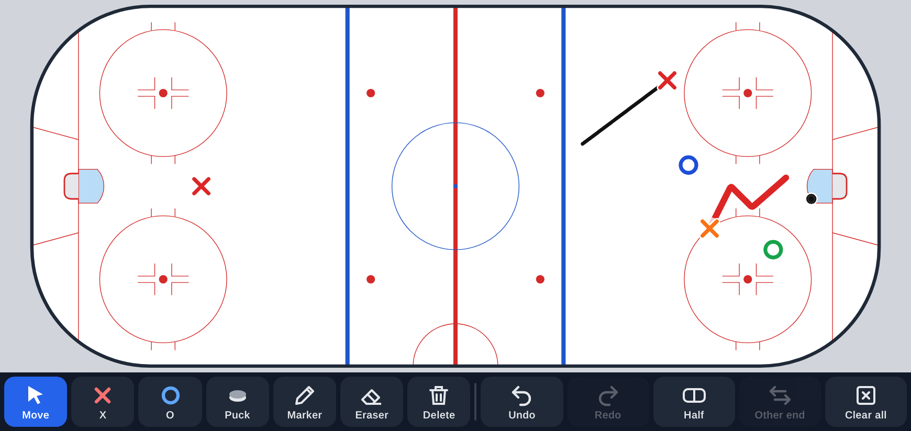
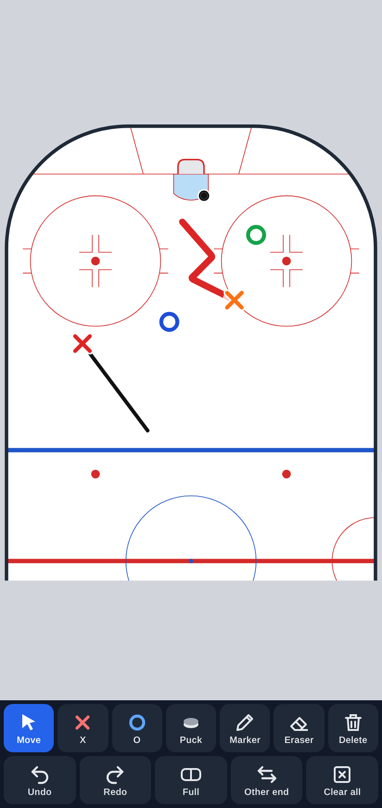
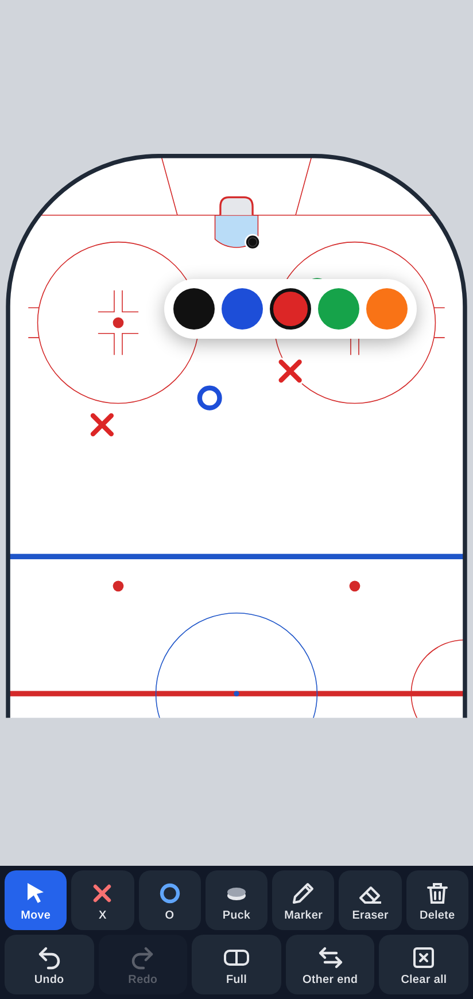
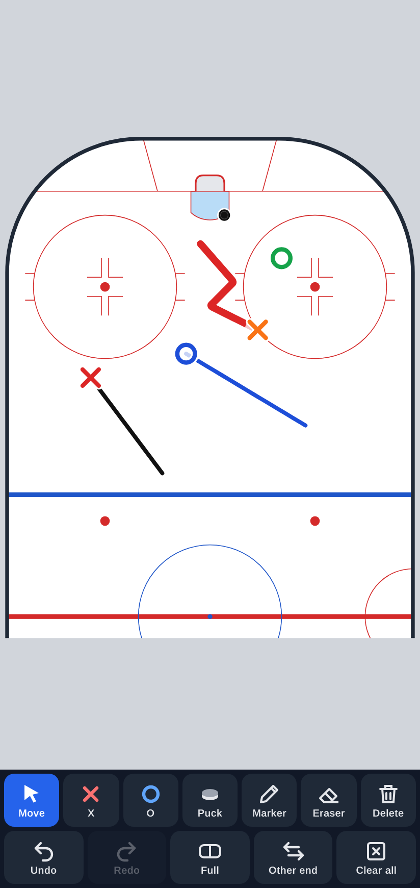

# Hockey Whiteboard

A single-file, mobile-first interactive ice hockey whiteboard: **https://keebeenator.github.io/hockey-whiteboard/**

- NHL rink drawn to scale (200 × 85 ft, 28 ft corners, blue/red/goal lines, creases, nets, faceoff circles and dots, referee crease).
- Landscape shows the full rink. Portrait shows a half rink turned vertically with the net at the top. **Full/Half** switches views manually, and **Other end** picks which half you see.
- Tools: Move, X / O players, Puck, Marker (5 colors, 3 widths), Eraser, Delete (tap an item, or drag an item onto the Delete button), Undo / Redo, Clear all.
- Long-press a player (~0.5 s) to change its color (black, blue, red, green, orange).
- The board saves to `localStorage`. Positions are stored as JSON in rink feet (origin at center ice), so set plays and animation frames can be added later.

| Landscape | Portrait | Colors | Drawing |
|---|---|---|---|
|  |  |  |  |
